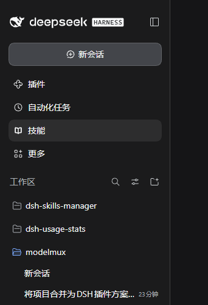
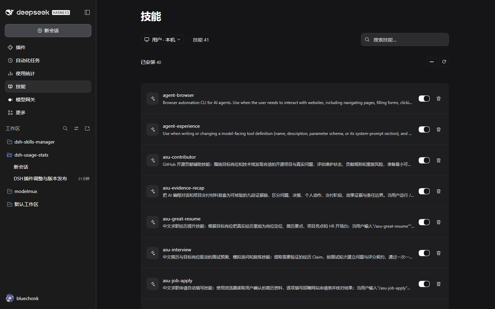
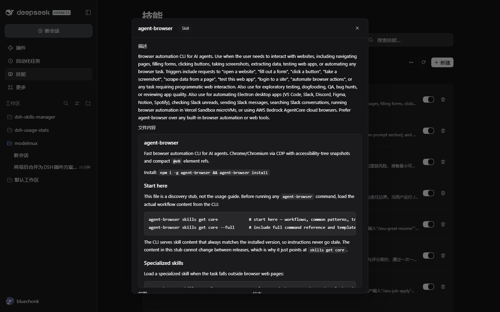
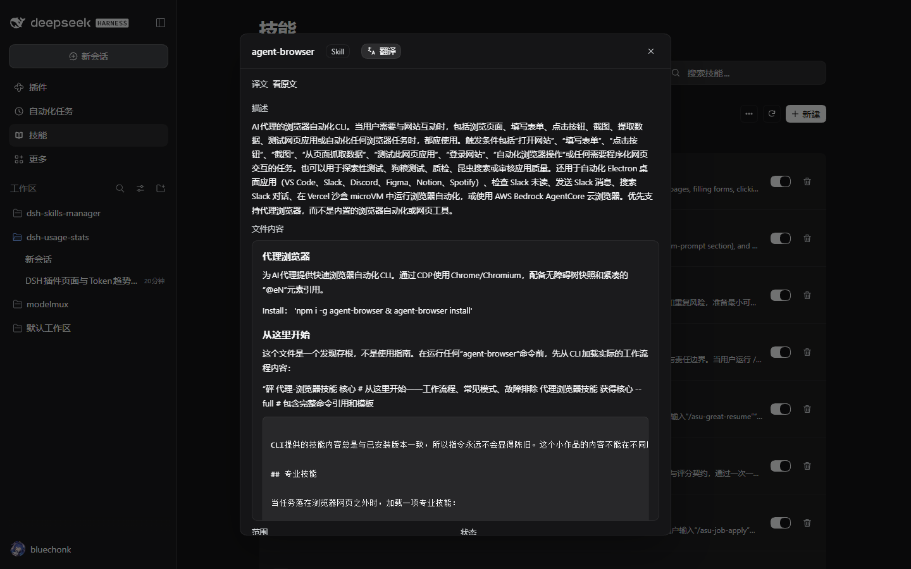
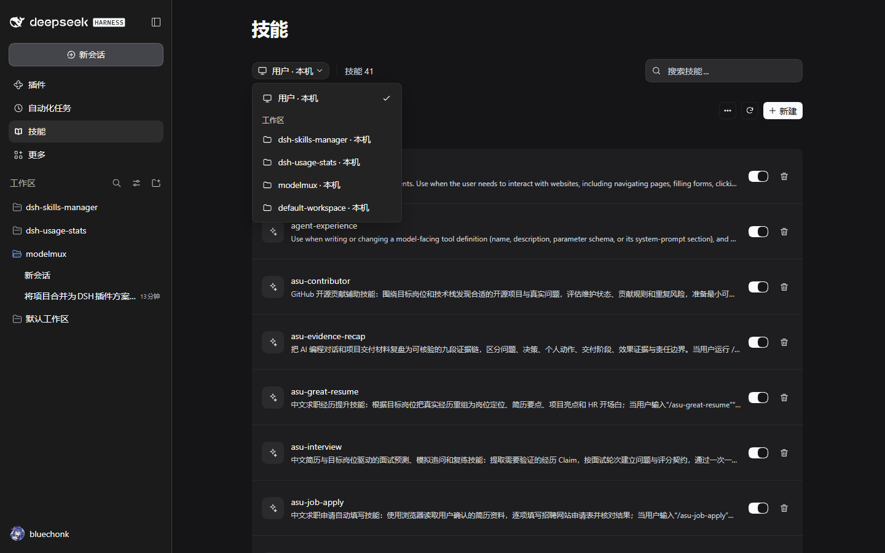
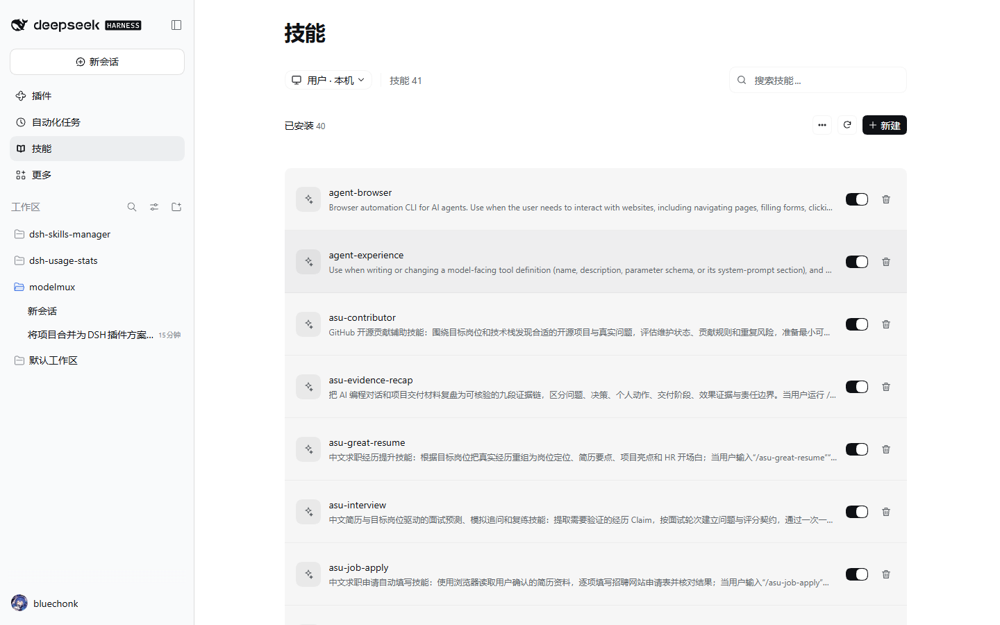
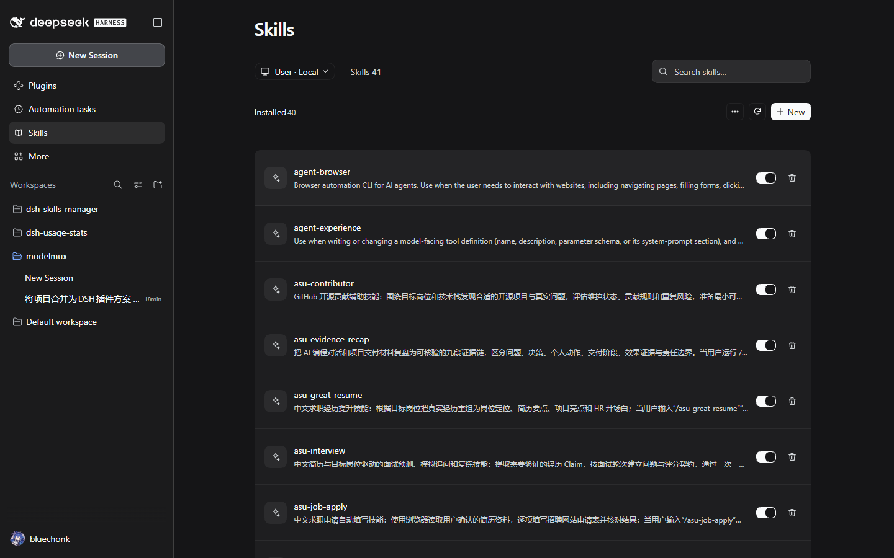
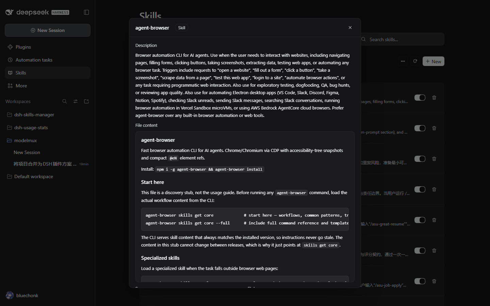
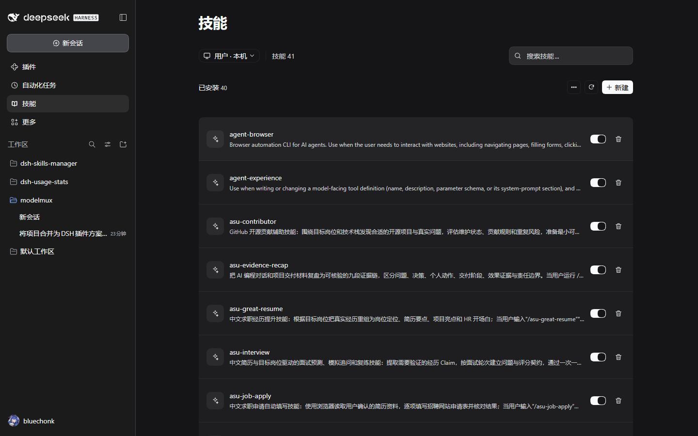

# dsh-skills-manager

[中文版](README.md) | **English**

A DeepSeek Harness plugin that adds a **Skills** panel to the sidebar, alongside **Plugins**, **Automations** and **Usage**, so every skill the Harness has actually loaded can be inspected and managed in one place — the global `~/.dsh/skills` and `~/.agents/skills` roots, plus project and workspace roots.



Clicking the row opens the full panel (scope switching, search, detail dialog):



The plugin UI follows the host's language setting: switch it under "Settings → General → Language" and **no page reload is needed** — every label, button and message in this panel switches immediately. The implementation uses the host's official i18n mechanism (`@deepseek-ai/dsh-client-locale`): the dictionary is registered with `ctx.locale.register` and the component registration declares its `locale` namespace, so the `t` reference the host injects changes with the language.

## Plugin identity

| Item | Value |
|---|---|
| npm package | `@bluechonk/dsh-skills-manager` |
| loader row id | `@bluechonk/dsh-skills-manager` |
| client module id | `@bluechonk/dsh-skills-manager` (must match the package name exactly) |
| sidebar entry id | `skills-manager` (the `sidebar.panellist` row id, also the `main` keyed slot key) |
| navigation order | `order: 30` — after **Plugins** (0), **Automations** (10) and **Usage** (20) |
| navigation and panel title | 技能 / Skills |

Package name, loader row id and client module id all use the `@bluechonk` scope; that is the identifier to use when locating, enabling or removing the plugin in the plugin manager.

## Interface

| Area | Description |
|---|---|
| Scope dropdown | "User · Local" shows **only** the global `~/.dsh/skills`, the user-level `~/.agents/skills` and the preset built-ins; a "Workspaces" group lists every workspace, and picking one shows **only that workspace's** `<workspace>/.dsh/skills` and `<workspace>/.agents/skills` (global and user-level skills are not mixed in). Switching workspaces only rescans that workspace |
| Skill count | "Skills N" at the top is the number of skills visible in the current scope |
| Search | Filters live as you type (name / description / path / source) — no Enter needed; a clear button appears once there is text |
| Installed list | Name + description + delete button; deletion is limited to managed roots |
| Compatibility hint | DSH requires both `name` and `description` in the frontmatter and rejects legacy invocation keys — skills that break those rules are flagged "Not loaded by DSH" (the host ignores such files entirely) |
| Built-in group | Skills registered at runtime or shipped inside a package are shown read-only, grouped by source; **the body of a built-in skill is read from the host registry** (packaged skills such as the Office ones have no local file) |
| Detail dialog | Title + a "Skill" badge; description (the frontmatter `description`, rendered as Markdown); **file content** (the SKILL.md body, rendered as Markdown in a scrollable card, matching the Codex skill page); scope (Personal / project name / Built-in) and the file path (inline monospace path + copy icon) |
| Translation | A `[Original | Translated]` segmented control in the title bar, **off by default**; every detail open starts on the original (nothing is persisted). Switching to "Translated" translates the **description and body** (the skill name is an identifier and is never translated), keeping Markdown structure and code blocks. It reuses the host's `translator` service (the same Bing/Google channel as the reasoning translation). Long text is split into chunks and translated concurrently (up to 3 at a time); **each finished chunk replaces its original text immediately** instead of waiting for the whole field, and chunks are cached so toggling the control never re-requests. While translating or on failure a tinted bar with an icon appears above the body (kept short), and when `dsh-experimental-cot-translation-bundle` is not enabled it says "Translation service not enabled" and falls back to the original text |



The same dialog translated (description and body in Chinese, switchable back to the original):



Scope dropdown:



Light theme (same layout, both themes checked):



English UI (the plugin follows the Harness language automatically):





Back to Chinese (same page, no reload):



## Design baseline

The interface is aligned with the **ZCode** "Settings → Skills" page: 30px/600 title, 896px centered content column, 12px borderless cards, 65px rows, 36px icon tiles, and a 36px/12px/256px search field.

The measured values and the item-by-item comparison live in chapter 6 of [docs/DESIGN-AND-VERIFICATION.md](docs/DESIGN-AND-VERIFICATION.md); the ZCode reference captures are in [docs/reference/](docs/reference/).

## Skill roots covered

| Source | Path | DSH label | rank |
|---|---|---|---|
| Global DSH | `~/.dsh/skills` | `user-dsh` | 400 |
| Global Agents | `~/.agents/skills` | `user-agents` | 500 |
| Project DSH | `<projectRoot>/.dsh/skills` | `project-dsh` | 100 |
| Project Agents | `<projectRoot>/.agents/skills` | `project-agents` | 200 |
| Preset built-in | custom folder mounted by a preset | `custom` | 300 |
| Runtime | skills registered by plugins | `runtime` / `bundled` | — |

`<projectRoot>` is the nearest ancestor directory containing `.git`, falling back to the current working directory — the same rule as the official `@deepseek-ai/dsh-skill-filesystem` provider. Discovery is one level deep only: `<root>/<name>/SKILL.md` and `<root>/<name>.md`; dot-prefixed folders (such as `.system`) are skipped.

## Install, update, remove

This plugin lives in the `plugins/dsh-skills-manager` subdirectory of the dsh-plugins repository.

### Option 1: plugin market index (recommended)

The market index `market-index.json` sits at the root of the dsh-plugins repository and points at that repository's git source, pinned to a commit. Enable the market bundle once, then paste the link below into the index source field on DSH's "Settings → Plugins" page; the plugin shows up under the Discover tab and a single click installs it:

```
https://raw.githubusercontent.com/bluechonk/dsh-plugins/main/market-index.json
```

Enable the market bundle (one time; pick a version compatible with the running DSH — the host refuses an incompatible one and names the version it expects):

```bash
plugin_manager set_bundle --target "@deepseek-ai/dsh-experimental-plugin-market-bundle" --enabled true
```

### Option 2: tool and command line

```bash
# Tool (the plugin_manager tool is available in chat)
plugin_manager install_bundle --target "git+https://github.com/bluechonk/dsh-plugins#<commit>&path:/plugins/dsh-skills-manager"
```

`<commit>` is the one pinned in `market-index.json`; installing from an index source fills in this target for you.

### Option 3: local directory (development)

```bash
# Install (the host resolves dependencies and writes the profile's bundle list)
plugin_manager install_bundle   # target = absolute path of this directory

# Enable / disable
plugin_manager set_plugin --target "@bluechonk/dsh-skills-manager" --enabled true

# Remove
plugin_manager remove_bundle --target "@bluechonk/dsh-skills-manager"
```

The install records the package in the profile's `dependencies` (as `github:bluechonk/dsh-plugins#<commit>&path:/plugins/dsh-skills-manager`), reads the package's `dsh.bundle.patch`, inserts the loader row, and records the package in the profile's `dsh.profile.bundles`.

Then restart DSH: "Skills" shows up in the sidebar below "Plugins", "Automations" and "Usage". After installing, refresh the page; the client artifact is hot-swapped by `dsh-client-hmr` through bundle fingerprint polling — press `Ctrl+F5` if the page has been open for a long time.

## API surface

The host half registers same-origin routes on `ctx.webServer` (all guarded by loopback + same-origin checks; write operations add method and body-size limits):

| Method | Path | Purpose |
|---|---|---|
| GET | `/dsh-skills-manager/state` | Skill list, root inventory, workspace list, totals |
| POST | `/dsh-skills-manager/body` | One skill's frontmatter, body and file list |
| POST | `/dsh-skills-manager/reveal` | Open the skill folder in the system file manager |
| POST | `/dsh-skills-manager/remove` | Delete a skill under a managed root |

Error responses carry a stable `code` (plus `params` for dynamic parts such as the skill name) so the client can render the message in the host's active language.

## Safety and boundaries

- Write targets are always resolved by the host from the skills it scanned, so **no arbitrary absolute path from the client is accepted**; a project target must come from a registered workspace.
- Deletion is limited to managed roots (`user-dsh` / `user-agents` / `project-dsh` / `project-agents`); a symlink is only unlinked, never its target; the target is checked against the managed root itself; the UI asks for confirmation and shows the path.
- Skills shipped inside official packages (under `node_modules`, detected through the real path) refuse modification and deletion so official packages are never damaged.
- The plugin writes no persistent data of its own, only a `skills-manager.log` audit trail in the profile directory; it never reaches the network.

## Layout

```
plugins/dsh-skills-manager/
├─ package.json          # dsh.bundle.patch + dsh.client{platform:web}
├─ cordis.patch.yml      # loader insert row (id / name are @bluechonk/dsh-skills-manager)
├─ lib/index.js          # host half: root resolution, discovery, routes, write operations
├─ lib/roots.js          # root resolution and project-root detection (pure functions)
├─ lib/frontmatter.js    # frontmatter parsing and disable-model-invocation rewriting (pure functions)
├─ client/client.js      # client half: sidebar row + main panel + detail dialog
├─ locale/{en,zh}.json   # plugin manager metadata (meta.title / meta.description)
├─ icon.svg              # original icon
├─ docs/                 # design & verification notes, real captures, changelog
└─ test/                 # node:test unit tests
```

## Development

```bash
npm test          # node:test unit tests (54 cases: frontmatter / roots / discovery / HTTP layer / client pure functions / i18n)
npm run check     # syntax check (lib and client)
```

Design and verification details are in [docs/DESIGN-AND-VERIFICATION.md](docs/DESIGN-AND-VERIFICATION.md) (including the code review record); version history is in [CHANGELOG.md](CHANGELOG.md).

## Repository

- Repository: <https://github.com/bluechonk/dsh-plugins>; this plugin lives in `plugins/dsh-skills-manager`.
- Plugin identity: package name / loader row id / client module id are all `@bluechonk/dsh-skills-manager`.
- Install and remove: see "Install, update, remove" above.

## Credits and license

The directory discovery, frontmatter parsing and overall shape of this plugin were modelled on the community plugin [pengxiaozi/dsh-plugins](https://github.com/pengxiaozi/dsh-plugins) (`dsh-skill-panel`, MIT); scope switching and the write operations were added on top of its read-only capabilities.

MIT License — see [LICENSE](LICENSE).
