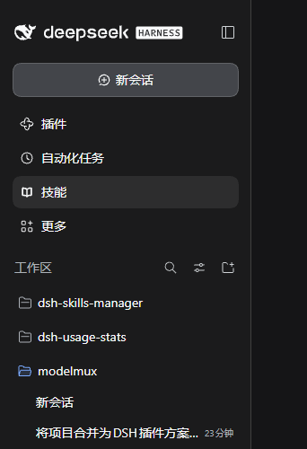
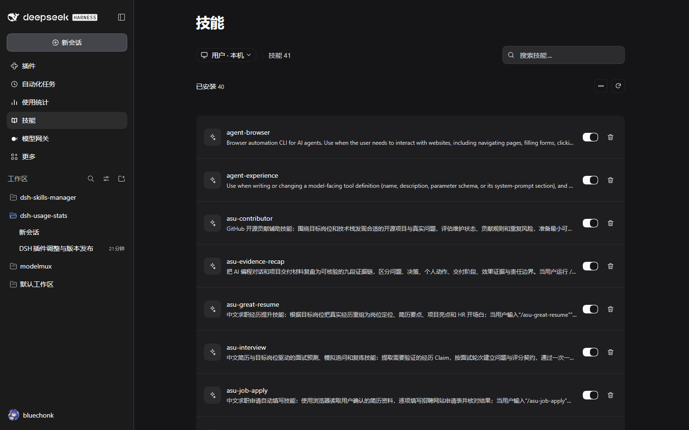
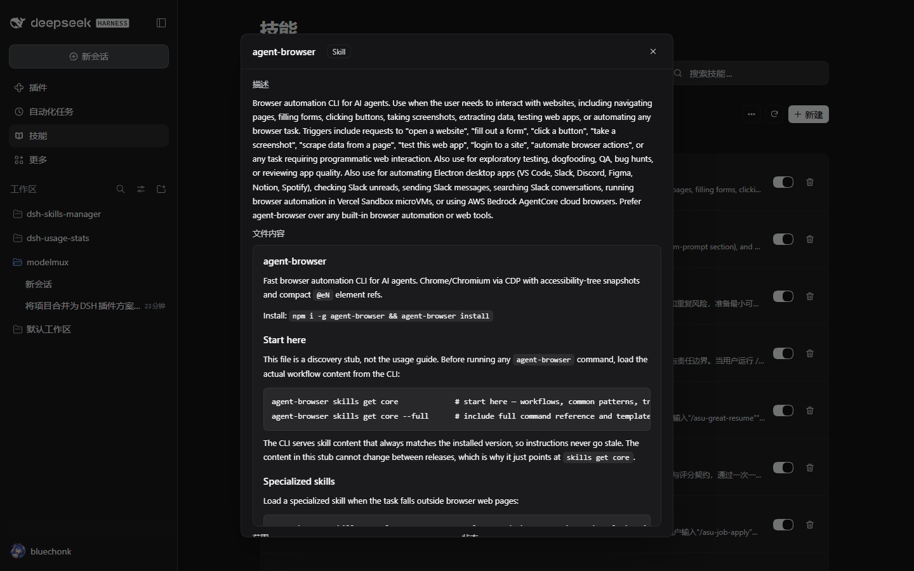
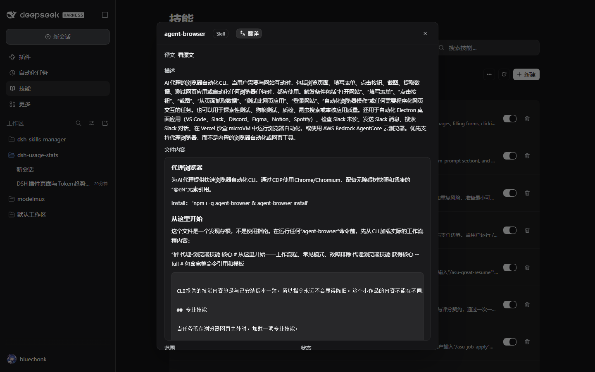
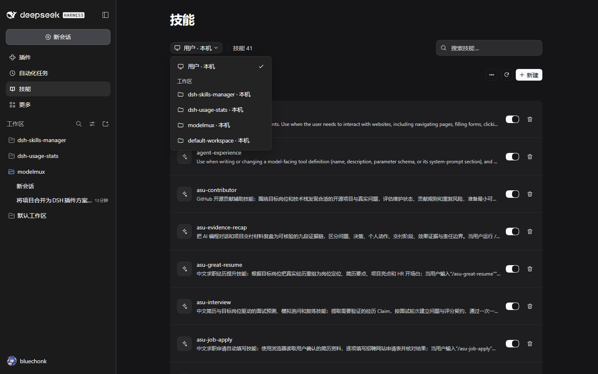
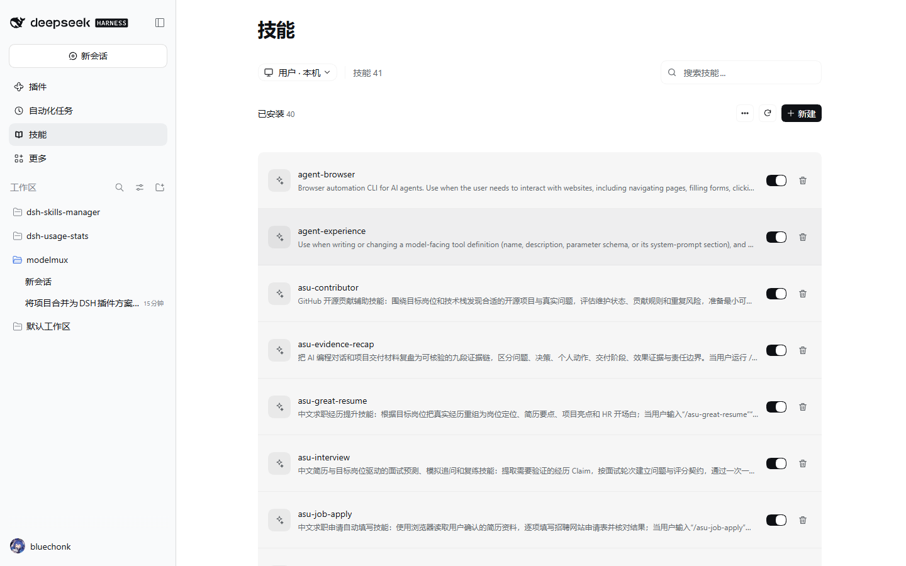
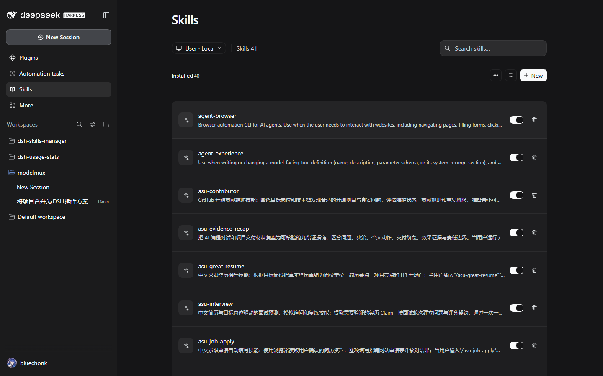
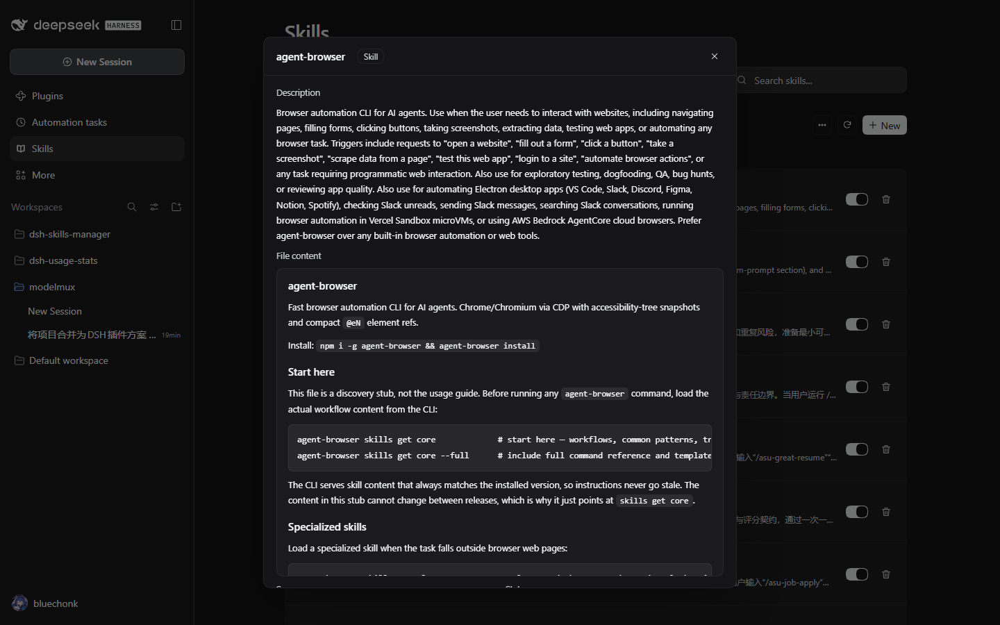
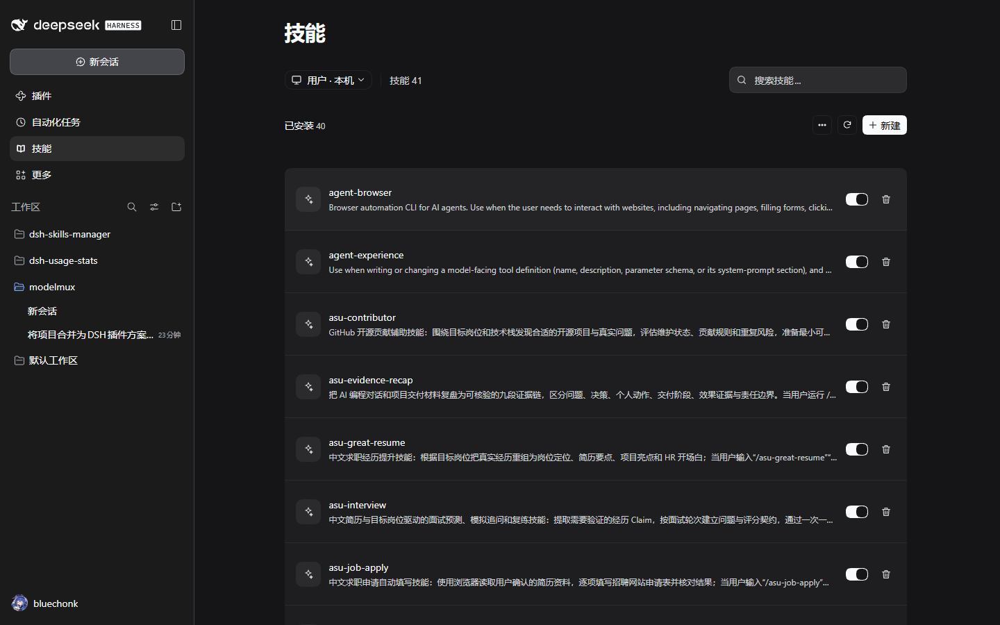

# dsh-skills-manager

**中文** | [English](README.en.md)

DeepSeek Harness 插件：在**侧边栏**新增「技能」独立面板（与「插件」「自动化任务」「使用统计」同级），集中展示并管理当前实际加载的全部 skill —— 全局 `~/.dsh/skills`、全局 `~/.agents/skills`、以及项目/工作区技能。

界面跟随宿主语言设置：在「设置 → 通用设置 → 语言」里切换，**不用刷新页面**，本面板所有文案（标题、按钮、提示、报错）立刻跟着变。实现走宿主官方 i18n 机制 `@deepseek-ai/dsh-client-locale`：`ctx.locale.register` 注册字典 + 组件注册项声明 `locale` 命名空间，宿主注入的 `t` 引用随语言切换而变。



点开导航行后是完整面板（作用域切换、搜索、详情弹窗）：



## 插件标识

| 项 | 值 |
|---|---|
| npm 包名 | `@bluechonk/dsh-skills-manager` |
| loader 行 id | `@bluechonk/dsh-skills-manager` |
| client 模块 id | `@bluechonk/dsh-skills-manager`（必须与包名逐字一致） |
| 侧边栏条目 id | `skills-manager`（`sidebar.panellist` 的导航行 id，同时是 `main` keyed 槽位的主面板键） |
| 导航顺序 | `order: 30` —— 排在「插件」(0) / 「自动化任务」(10) / 「使用统计」(20) 之后 |
| 导航与面板标题 | 技能 / Skills |

包名、loader 行 id、client 模块 id 三者统一使用 `@bluechonk` scope，插件管理器里定位、启用与卸载都以此为准。

## 界面

| 区域 | 说明 |
|---|---|
| 作用域下拉 | 「用户 · 本机」只显示全局 `~/.dsh/skills`、用户级 `~/.agents/skills` 与预设内置技能；「工作区」分组列出各工作区，**选中某个工作区就只显示该工作区的** `<工作路径>/.dsh/skills` 与 `<工作路径>/.agents/skills`（不混入全局/用户级）。切换工作区只重扫该工作区 |
| 技能计数 | 顶部「技能 N」为当前作用域可见的技能总数 |
| 搜索 | 按名称、描述、路径实时过滤 |
| 已安装列表 | 名称 + 描述 + 删除按钮；删除只允许落在受管根之下 |
| 兼容性提示 | DSH 要求 frontmatter 同时有 `name` 与 `description`，且不含旧式调用键——不满足的技能标「DSH 不加载」（这类文件会被宿主整个忽略） |
| 内置分组 | 运行时注册与随包内置的技能只读展示，按来源分组；**内置技能的正文从宿主注册表读取**（打包在 `app.asar` 里的技能没有本地文件） |
| 搜索 | 随输入实时过滤（名称 / 描述 / 路径 / 来源），不用回车；有内容时右侧出现清除按钮 |
| 详情弹窗 | 标题 +「Skill」徽章；描述（frontmatter 的 `description`，Markdown 渲染）；**文件内容**（SKILL.md 正文，Markdown 渲染的滚动卡片，形态对齐 Codex 技能页）；范围（个人 / 项目名 / 内置）、文件路径（行内等宽路径 + 复制图标） |
| 翻译 | 标题栏一个 `[原文 | 译文]` 分段按钮，**默认原文**，每次打开详情都从原文开始（不持久化）。切到「译文」才翻译**描述与正文**（技能名是标识符，不翻译），Markdown 结构与代码块保留。长文本分块后并发翻译（并发上限 3），**译好一块立即替换该块**，不必等全部完成。结果**落盘缓存**（`~/.dsh/profiles/<profile>/skills-manager-translation-cache.json`），下次打开直接命中、不再请求；选中「译文」时标题栏出现「重新翻译」按钮，点击会绕过缓存重译并覆盖旧缓存。复用宿主的 `translator` 服务（与「思考过程机器翻译」同一套 Bing/Google 通道）；翻译中或失败时在正文上方给一条浅底提示（带图标，文案精简），未启用 `dsh-experimental-cot-translation-bundle` 时提示「翻译服务未启用」并退回原文 |



翻译后的详情弹窗（描述与正文均为中文，可切回原文）：



作用域下拉：



浅色主题（同一套布局，深浅两版都已核对）：



英文界面（DSH 切成英文时自动跟随）：





切回中文（同一页面，无需刷新）：



## 设计基准

界面按本机 **ZCode**「设置 → 技能」页对齐：标题 30px/600、内容列 896px 居中、卡片 12px 无描边、行高 65px、图标块 36px、搜索框 36px/12px/256px。
实测参数与逐项对照见 [docs/DESIGN-AND-VERIFICATION.md](docs/DESIGN-AND-VERIFICATION.md) 第六章，ZCode 取材截图见 [docs/reference/](docs/reference/)。

## 覆盖的技能根

| 来源 | 路径 | DSH 标签 | rank |
|---|---|---|---|
| 全局 DSH | `~/.dsh/skills` | `user-dsh` | 400 |
| 全局 Agents | `~/.agents/skills` | `user-agents` | 500 |
| 项目 DSH | `<projectRoot>/.dsh/skills` | `project-dsh` | 100 |
| 项目 Agents | `<projectRoot>/.agents/skills` | `project-agents` | 200 |
| 预设内置 | preset 挂载的自定义目录 | `custom` | 300 |
| 运行时 | 插件注册的内置技能 | `runtime` / `bundled` | — |

`<projectRoot>` 取含 `.git` 的最近祖先目录，没有则取当前工作目录 —— 与官方提供方 `@deepseek-ai/dsh-skill-filesystem` 的规则一致。目录扫描只认一层：`<root>/<name>/SKILL.md` 与 `<root>/<name>.md`，`.` 开头的目录（如 `.system`）跳过。

## 安装、更新、卸载

本插件是 dsh-plugins 仓库的子目录 `plugins/dsh-skills-manager`。

### 方式一：插件市场索引（推荐）

市场索引 `market-index.json` 位于 dsh-plugins 仓库根目录，指向 dsh-plugins 仓库的 git 源并锁定 commit。启用市场 bundle 后，
在 DSH「设置 → 插件」页的索引源输入框粘贴下面这条地址，Discover 标签里就会出现本插件，点「安装」即可：

```
https://raw.githubusercontent.com/bluechonk/dsh-plugins/main/market-index.json
```

启用市场 bundle（一次性；注意版本要与当前 DSH 运行时兼容，不兼容时宿主会拒绝启用并提示对应版本）：

```bash
plugin_manager set_bundle --target "@deepseek-ai/dsh-experimental-plugin-market-bundle" --enabled true
```

### 方式二：命令行 / 工具

```bash
# 工具（对话里可用 plugin_manager 工具）
plugin_manager install_bundle --target "git+https://github.com/bluechonk/dsh-plugins#<commit>&path:/plugins/dsh-skills-manager"
```

`<commit>` 取 `market-index.json` 里锁定的提交；用索引源安装时宿主会自动带上这个 target，不用手填。

### 方式三：本地目录（开发用）

```bash
# 安装（宿主负责解析依赖并写入 profile 的 bundles 列表）
plugin_manager install_bundle   # target = 本目录绝对路径

# 启用 / 停用
plugin_manager set_plugin --target "@bluechonk/dsh-skills-manager" --enabled true

# 卸载
plugin_manager remove_bundle --target "@bluechonk/dsh-skills-manager"
```

装完宿主会把包写进 profile 的 `dependencies`（值为 `github:bluechonk/dsh-plugins#<commit>&path:/plugins/dsh-skills-manager`），
并读取本包的 `dsh.bundle.patch` 自动插入 loader 行、把包名写进 `dsh.profile.bundles`。

然后重启 DSH，侧边栏「插件」「自动化任务」「使用统计」下方就会出现「技能」。安装后刷新页面即可，客户端产物由 `dsh-client-hmr` 的 bundle 指纹轮询热替换；页面长时间未刷新时手动 `Ctrl+F5` 即可。

## 数据通道

宿主半在 `ctx.webServer` 上注册同源路由（全部带回环 + 同源守卫，写操作另有方法与体积限制）：

| 方法 | 路径 | 用途 |
|---|---|---|
| GET | `/dsh-skills-manager/state` | 技能列表、根清单、工作区列表、统计 |
| POST | `/dsh-skills-manager/body` | 单个技能的 frontmatter、正文、文件清单 |
| POST | `/dsh-skills-manager/reveal` | 在系统文件管理器中打开技能目录 |
| POST | `/dsh-skills-manager/remove` | 删除受管根下的技能 |

## 安全与边界

- 写操作的目标一律由宿主按「已扫描到的技能」反查得到，**不接受客户端传入的任意绝对路径**；项目落点只认已登记工作区。
- 删除仅限受管根（`user-dsh` / `user-agents` / `project-dsh` / `project-agents`）；软链只删链接不删源；删除前校验目标不等于受管根本身；界面上有二次确认并列出路径。
- 官方包内置技能（`node_modules` 内，按真实路径判定）拒绝改写与删除，避免破坏官方包。
- 插件不写任何持久化数据，仅在 profile 目录留一份 `skills-manager.log` 审计日志；不联网、不上传。

## 目录结构

```
plugins/dsh-skills-manager/
├─ package.json          # dsh.bundle.patch + dsh.client{platform:web}
├─ cordis.patch.yml      # loader 插入行（id / name 均为 @bluechonk/dsh-skills-manager）
├─ lib/                  # host 半（ESM，可自由拆分）
│  ├─ index.js           #   装配：路由、翻译缓存、槽位注册
│  ├─ http.js            #   同源守卫 / JSON 响应 / 请求体读取
│  ├─ scan.js            #   技能根扫描与文件清单
│  ├─ roots.js           #   根解析与项目根探测（纯函数）
│  └─ frontmatter.js     #   frontmatter 解析与改写（纯函数）
├─ src/client/           # client 半源码（按职责分模块）
│  ├─ index.js           #   入口：__ModuleLoader__ 工厂
│  ├─ runtime.js         #   React 绑定（宿主注入）
│  ├─ api.js / i18n.js / translate.js
│  ├─ markdown.js / icons.js / styles.js / components.js
│  └─ detail.js / panel.js / pure.js
├─ client/client.js      # client 半产物（单文件 factory，由构建生成，不要手改）
├─ locale/{en,zh}.json   # 插件管理器元数据（meta.title / meta.description）
├─ icon.svg              # 原创图标
├─ docs/                 # 设计与验证记录、实机截图、变更记录
└─ test/                 # node:test 纯函数单测
```

## 开发

```bash
npm install           # 在仓库根目录，装 esbuild（仅构建需要）
npm run build         # 在仓库根目录，把 src/client/ 打包成 client/client.js
npm test              # node:test 单测（57 项：frontmatter / 根解析 / 目录扫描 / HTTP 层 / 翻译缓存 / 客户端纯函数 / i18n）
npm run check         # 语法检查（lib / client / src）
```

**为什么 client 半有源码和产物两份**：DSH 的 client 产物是被 `__ModuleLoader__` 的 `factory(require)` 包裹的单文件（官方约定，见 `cordis-plugin-development` 技能的 `templates/decoration/client.js`）。源码按职责拆在 `src/client/`，构建期用 esbuild 打包成 `client/client.js`；装插件的人只需要产物，esbuild 是仓库根的 devDependency。

推送门禁在 dsh-plugins 仓库根目录：`.githooks/pre-push` 会在 WSL（Ubuntu）里跑与 CI 等价的 `npm run check && npm test`，
不通过就中止推送（换机器克隆后需 `npm run hooks:install` 重新启用）。

设计与验证细节见 [docs/DESIGN-AND-VERIFICATION.md](docs/DESIGN-AND-VERIFICATION.md)（含代码评审与修复记录），
翻译功能的核心实现与设计理念见 [docs/TRANSLATION.md](docs/TRANSLATION.md)，版本变更见 [CHANGELOG.md](CHANGELOG.md)。

## 版本

| 版本 | 要点 |
|---|---|
| 0.1.1 | 界面调整：去掉启停开关与导入，翻译改分段按钮（默认原文），搜索实时过滤，内置技能显示正文 |
| 0.1.0 | 首个版本：侧边栏「技能」面板，作用域切换、搜索、Markdown 详情与机器翻译、删除 |

发版节奏：一批用户可见的改动发一个版本，不随单次提交发版。详单见 [CHANGELOG.md](CHANGELOG.md)。

## 仓库

- 所在仓库：<https://github.com/bluechonk/dsh-plugins>，本插件位于 `plugins/dsh-skills-manager`。
- 插件标识：包名 / loader 行 id / client 模块 id 统一为 `@bluechonk/dsh-skills-manager`。
- 安装与卸载见上文「安装、更新、卸载」。

## 致谢与许可

本插件的目录扫描、frontmatter 解析与整体形态参考了社区插件 [pengxiaozi/dsh-plugins](https://github.com/pengxiaozi/dsh-plugins) 的 `dsh-skill-panel`（MIT），并在其只读能力之上补齐了范围切换与写操作。

MIT License，见 [LICENSE](LICENSE)。
